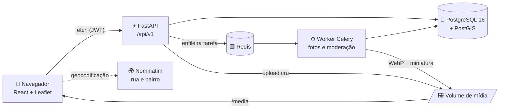
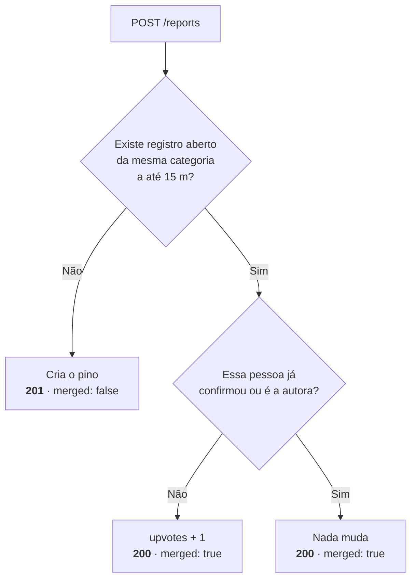

<div align="center">

# 🗺️ ComuniMap

**Mapeamento urbano colaborativo de Três Lagoas - MS**

Perigos e riscos · Caridades e doações · Pontos e eventos comunitários


<br>


</div>

---

## Sumário

- [O que é](#o-que-é)
- [Arquitetura](#arquitetura)
- [Rodando local](#rodando-local)
- [Estrutura de pastas](#estrutura-de-pastas)
- [API](#api)
- [Regras de negócio](#regras-de-negócio)
- [Testes](#testes)
- [Configuração](#configuração)
- [Antes de implantar o piloto](#antes-de-implantar-o-piloto)

## O que é

O ComuniMap é um mapa onde os moradores registram o que acontece na cidade:

| | Categoria | Exemplos |
| :-: | --- | --- |
| ⚠️ | **Perigos e riscos** | Buraco na via, fios soltos, com nível de risco alto, médio ou baixo |
| 🤝 | **Caridades e doações** | Quem precisa e quem oferece alimentos, roupas, móveis, com contato de WhatsApp |
| 🥳 | **Eventos** | Festas e feiras, com horário |
| 🏘️ | **Pontos comunitários** | Praças, associações, locais de referência |

Cada registro tem um pino no mapa escuro, foto opcional e confirmações de outros moradores
("também vi isso").

> **Sobre o arquivo `ComuniMap.index.html`**
> É a primeira versão do projeto: uma página só, com os dados no `localStorage` do navegador.
> Ela continua na raiz porque é o que o GitHub Pages serve hoje, e sai quando a API estiver
> publicada.

## Arquitetura



| Parte | Stack |
| --- | --- |
| [`frontend/`](frontend) | React 19 + TypeScript, Vite, Tailwind 3.4, TanStack Query, Leaflet |
| [`backend/`](backend) | Python 3.13, FastAPI, SQLAlchemy 2.0 (async), GeoAlchemy2, Pydantic v2, Alembic |
| [`docker-compose.yml`](docker-compose.yml) | PostgreSQL 16 + PostGIS, Redis, API e worker Celery |

## Rodando local

Você precisa de [Docker](https://www.docker.com/products/docker-desktop/) e
[Node.js](https://nodejs.org/) 20 ou mais novo.

```bash
# 1. API, banco, Redis e worker
docker compose up -d --build

# 2. Front-end
cd frontend
npm install
npm run dev
```

| Serviço | Endereço |
| --- | --- |
| 🗺️ App | http://localhost:5273 |
| 📖 API (documentação interativa) | http://localhost:8010/docs |
| 🐘 Postgres | `localhost:5442` (usuário, senha e banco: `comunimap`) |
| 🟥 Redis | `localhost:6389` |

As migrações rodam sozinhas quando o `backend` sobe. As portas fogem do padrão de propósito, para
não colidir com outros projetos na mesma máquina; para trocar, veja [Configuração](#configuração).

Para desligar: `docker compose down` (os dados ficam no volume; `down -v` apaga tudo).

## Estrutura de pastas

```
ComuniMap/
├── ComuniMap.index.html      # versão antiga (GitHub Pages atual)
├── docker-compose.yml        # db · redis · backend · worker
├── .env.example
│
├── frontend/
│   ├── index.html
│   └── src/
│       ├── App.tsx           # layout: mapa + lista + modais
│       ├── api/              # cliente fetch (JWT), auth, reports
│       ├── components/       # AuthScreen, Header, MapView, Feed, LocationPicker,
│       │   └── forms/        #   PhotoField, StreetField e os três formulários
│       ├── context/          # sessão e notificações
│       ├── hooks/            # dados da API e localização do formulário
│       └── lib/              # GPS, Nominatim, compressão WebP, ruas da cidade
│
└── backend/
    ├── Dockerfile
    ├── alembic/versions/     # migrações (schema + tenant inicial)
    ├── app/
    │   ├── main.py · config.py · db.py · security.py
    │   ├── models/           # tenant, user, report
    │   ├── schemas/          # Pydantic v2
    │   ├── api/v1/           # rotas de auth e reports
    │   ├── services/         # regra espacial dos 15 m
    │   └── worker/           # Celery: fotos e moderação
    └── tests/
```

## API

Todas as rotas ficam sob `/api/v1`. Ler é público; criar, confirmar e excluir exige login
(`Authorization: Bearer <token>`).

| Método | Rota | O que faz |
| :-: | --- | --- |
| `POST` | `/auth/register` | Cria a conta (senha guardada com Argon2) |
| `POST` | `/auth/login` | Devolve o token JWT |
| `GET` | `/auth/me` | Dados de quem está logado |
| `GET` | `/reports` | Lista. Filtros: `category`, `status`, `tenant`, `bbox`, `q` |
| `POST` | `/reports` | Cria um registro, ou soma um upvote ([regra dos 15 m](#-regra-dos-15-metros)) |
| `GET` | `/reports/{id}` | Um registro |
| `POST` | `/reports/{id}/upvote` | "Também vi isso", uma vez por pessoa |
| `POST` | `/reports/{id}/photo` | Envia a foto; o worker processa em segundo plano |
| `PATCH` | `/reports/{id}/status` | `pending` → `in_progress` → `resolved` (só equipe do tenant) |
| `DELETE` | `/reports/{id}` | Só quem criou, ou a equipe do tenant |

<details>
<summary><b>Exemplo: criar um registro</b></summary>

```bash
curl -X POST http://localhost:8010/api/v1/reports \
  -H "Authorization: Bearer $TOKEN" \
  -H "Content-Type: application/json" \
  -d '{
    "category": "perigo",
    "title": "Buraco na via",
    "description": "Buraco grande na pista, sentido centro.",
    "neighborhood": "Centro",
    "street": "Rua Paranaíba",
    "risk_level": "alto",
    "lat": -20.7868,
    "lng": -51.7018
  }'
```

Resposta `201` (pino novo) ou `200` com `"merged": true` (já existia um igual a menos de 15 m):

```json
{
  "id": "6535d208-7080-42a0-8023-8c1a745692e5",
  "category": "perigo",
  "title": "Buraco na via",
  "lat": -20.7868,
  "lng": -51.7018,
  "risk_level": "alto",
  "upvotes": 0,
  "status": "pending",
  "photo_status": "none",
  "merged": false
}
```

</details>

## Regras de negócio

### 📍 Regra dos 15 metros

No `POST /reports`, antes de criar, a API procura com `ST_DWithin` um registro **aberto**, da
**mesma categoria**, a até 15 m do ponto. Se achar, não cria outro pino: soma um upvote no que já
existe.



- A distância é medida em **metros** (`location::geography`), com um índice GIST de expressão
  dedicado. A coluna `location` é `Geometry(POINT, 4326)` e tem o próprio índice GIST.
- Cada pessoa conta um upvote só, e o autor não confirma o próprio registro.
- Registros `resolved` não absorvem novos: se o buraco voltou, é um registro novo.
- Envios simultâneos do mesmo local não geram pino duplicado (trava por categoria na transação).

### 🏛️ Multi-tenant (B2G)

A tabela `tenants` guarda cada prefeitura ou concessionária com o polígono `boundary` da área
atendida. Todo registro novo é atribuído ao tenant cujo polígono cobre o ponto (`ST_Covers`); fora
de qualquer área, fica sem tenant. Usuários com papel `agent` mudam o status dos registros do seu
tenant.

### 📷 Fotos

1. O navegador reduz a foto para até 1600 px e converte para **WebP** antes de enviar.
2. A API guarda o arquivo cru fora da pasta pública e responde `202`.
3. O worker confere que é mesmo uma imagem, regrava em WebP (o que remove EXIF e GPS) e gera a
   miniatura.

### 🧭 Localização no formulário

Ao abrir um modal, o app pede o GPS do aparelho e posiciona um **pino arrastável** num mini-mapa.
Soltar o pino preenche Rua e Bairro por geocodificação reversa (Nominatim). Digitar o endereço
continua valendo como alternativa: sem pino, o endereço é geocodificado no envio.

### 🛡️ Moderação

Depois de criado, cada registro passa por uma tarefa do worker. Hoje ela só compara o texto com
uma lista de termos (`MODERATION_BLOCKLIST`) e esconde o que bater. É o ponto de encaixe para uma
moderação de verdade.

## Testes

```bash
docker compose exec backend pytest        # 24 testes
docker compose exec backend ruff check .  # lint
cd frontend && npm run build              # typecheck + build
```

Os testes do back-end criam e usam o banco `comunimap_test`. O banco de desenvolvimento nunca é
tocado.

## Configuração

Tudo tem valor padrão, então o projeto sobe sem nenhum arquivo `.env`. Para mudar algo, copie o
exemplo e edite.

**Raiz (`.env.example` → `.env`)**, lido pelo Docker Compose:

| Variável | Padrão | Para que serve |
| --- | --- | --- |
| `API_PORT` · `DB_PORT` · `REDIS_PORT` | `8010` · `5442` · `6389` | Portas no seu computador |
| `POSTGRES_USER` · `POSTGRES_PASSWORD` · `POSTGRES_DB` | `comunimap` | Credenciais do banco |
| `SECRET_KEY` | valor de desenvolvimento | Assinatura dos tokens de login |
| `CORS_ORIGINS` | `http://localhost:5273,...` | Endereços do front liberados na API |
| `MODERATION_BLOCKLIST` | vazio | Termos que escondem um registro |

**Front (`frontend/.env.example` → `frontend/.env`)**:

| Variável | Padrão | Para que serve |
| --- | --- | --- |
| `VITE_API_BASE_URL` | vazio (mesma origem) | Endereço público da API em produção |
| `VITE_CARTO_API_KEY` | vazio | Chave do tema escuro CARTO Dark Matter |
| `VITE_DEV_API_TARGET` | `http://localhost:8010` | Para onde o Vite repassa `/api` em desenvolvimento |

## Antes de implantar o piloto

- [ ] **Chave do mapa.** Desde 25/09/2026 o CARTO só entrega o tema Dark Matter com chave. Peça a
      gratuita em https://carto.com/basemaps/apikey e coloque em `VITE_CARTO_API_KEY`. Sem ela o
      app usa OpenStreetMap com filtro escuro.
- [ ] **Polígono do tenant.** O de Três Lagoas na migração `0002` é um retângulo aproximado.
      Trocar pela malha municipal oficial do IBGE.
- [ ] **`SECRET_KEY`.** Gerar um valor próprio. A API se recusa a subir com
      `ENVIRONMENT=production` e o valor de desenvolvimento.
- [ ] **Publicação.** O `docker-compose.yml` é de desenvolvimento (código montado, `--reload`,
      imagem com dependências de teste). Produção precisa de imagem própria, HTTPS e
      `CORS_ORIGINS` com o domínio real.
- [ ] **Nominatim.** O serviço público aceita no máximo 1 requisição por segundo e não tem
      garantia. Com volume real, usar instância própria ou um provedor contratado.
- [ ] **Contas.** Não há confirmação de e-mail nem recuperação de senha. Agentes e admins são
      promovidos direto no banco (`users.role`, `users.tenant_id`).
- [ ] **Moderação.** Definir o processo real (serviço externo ou revisão humana).
- [ ] **LGPD.** O WhatsApp informado em doações fica público no mapa. Falta aviso de
      consentimento e política de privacidade.
